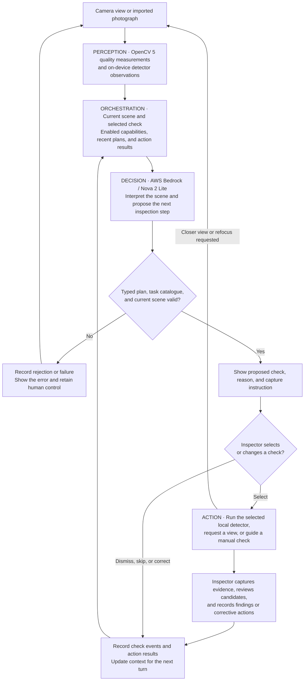
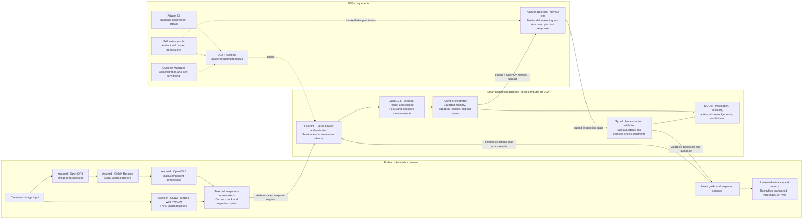

# Burhan · برهان

Burhan is an AI-guided construction inspection app built for the hackathon. Its core is **Smart Inspection**: an assistant that interprets the camera view, proposes relevant inspection checks, and guides the inspector toward the evidence to collect next. On-device visual detection supports this guided workflow, connecting observations to inspector review, corrective actions, and English/Arabic reports.

The main Android and browser application lives in [`burhan/`](burhan/). This repository also contains the Python edge dashboard, model experiments, public-data research, and evaluation records behind the project.

## Start here

| You want to… | Go to |
|---|---|
| Understand perception, planning, and actions | [Agent workflow](#agent-workflow) and [architecture](#architecture) |
| Inspect the OpenCV-to-action trace and evaluation | [Recorded demonstration](#opencv-5-changes-the-next-action) and [evaluation](#evaluation-and-human-control) |
| Set up the Smart Inspection service | [Smart Inspection backend](#smart-inspection-backend) |
| Try Burhan without a phone or emulator | [Run the browser app](#run-the-browser-app) |
| Build and install the Android app | [Android build](#android-build) |
| Explore factory, freight, road, and construction experiments | [Python edge dashboard](#python-edge-dashboard) |
| Find source code, models, reports, or research | [Repository map](#repository-map) and [documentation](#documentation) |

For the full Burhan experience, run the Smart Inspection backend, launch the browser or Android app, and pair them in Settings. Smart Inspection requires internet access for AI guidance; visual detection runs on the device. The separate Python edge dashboard is for experiments and is not required to run Burhan. Commands below use PowerShell, with the working directory identified in each section.

## Agent workflow

Smart Inspection follows a **perception → decision → action → feedback** loop. OpenCV 5 measurements and local detector observations become inputs to the next planning turn. The agent proposes bounded inspection actions; the inspector chooses the active check and reviews the evidence.



The action vocabulary is `select_detector`, `request_view`, `request_manual_check`, `ask_context`, and `prepare_finding`. A detector proposal does not start a detector until the user selects its check. The implementation is in the [backend orchestration](burhan/backend/app.py), [plan/action schemas](burhan/backend/models.py), [capability registry](burhan/backend/capabilities.py), and [client guide controller](burhan/src/engine/SmartGuide.tsx).

## Architecture



OpenCV 5 is used in Android inference preparation/decoding and independently in the Python backend for image-quality measurements. Browser inference uses WASM; its snapshots receive the same backend OpenCV analysis. The AWS request is implemented in the [Bedrock adapter](burhan/backend/providers.py). EC2, S3, IAM, and Systems Manager describe the supplied [CloudFormation deployment path](burhan/backend/deploy/aws-ec2.yaml).

## OpenCV 5 changes the next action

The [recorded two-turn trace](burhan/delivery/evaluation/backend-real.json) shows the same permitted site photograph followed by a deliberately defocused version. The backend computes `context.backendQuality` with OpenCV 5 and passes it into the planner alongside the snapshot and previous action acknowledgements.

| Trace field | First view | Defocused view |
|---|---|---|
| OpenCV version | `5.0.0` | `5.0.0` |
| `laplacianVariance` | `1098.82` | `1.05` |
| Relevant action | `request_view`, ID `view-glazing` | `request_view`, ID `refocus-pending-view` |
| Next instruction, summarized | Capture a closer view of the panel and frame edges, keeping detail sharp. | Hold still, tap to refocus, and capture one sharp image. |
| Turn outcome | `completed` | `completed` |
| Action acknowledgement | `accepted` | `accepted` |

The second decision's reason explicitly cites Laplacian variance **1.05** and prioritizes restoring focus. The trace records `guidanceChanged: true`, with `perception → decision → tool_results` events for both turns. OpenCV output therefore participates in the later action choice rather than appearing only as a dashboard statistic.

This is a controlled capture-quality demonstration: both the photograph's detail and its measured quality change, so it does not isolate the metric from the image as a causal ablation. `accepted` acknowledges an instruction; it does not claim a physical inspection or capture was performed. The saved run used a different configured planner provider and is not a live AWS receipt. The [verification record](burhan/delivery/verification.json) identifies AWS coverage as transport-stub contract.

### Reproduce the AWS demonstration

Start and pair the backend using the [AWS setup below](#smart-inspection-backend). Confirm the health response reports `provider: aws` and `ready: true`, then run from the repository root, replacing the image path with a permitted photograph:

```powershell
Invoke-RestMethod http://127.0.0.1:3210/api/v1/health
./burhan/backend/.venv/Scripts/python.exe burhan/scripts/test-smart-backend.py --url http://127.0.0.1:3210 --image "C:/path/to/permitted-site-photo.jpg" --output output/judging/smart-inspection-trace.json
```

This submits two online planning turns. The [reproduction script](burhan/scripts/test-smart-backend.py) records the actual provider, source hash, OpenCV measurements, decisions, turn timing, and action acknowledgements without saving pairing credentials. Inspect the output for two completed turns, OpenCV version 5, reduced sharpness in the second view, changed guidance, and the corresponding trace events. Keep failures in the record if a turn does not complete.

## Evaluation and human control

| Area | What is evaluated | Evidence and observed scope |
|---|---|---|
| Task success | Image/context submission produces a bounded plan; changed capture quality changes the next instruction. | The [two-turn run](burhan/delivery/evaluation/backend-real.json) completed 2/2 turns and recorded changed guidance. This evaluates the guidance workflow, not defect accuracy or completed physical inspection. |
| Failure handling | Invalid images, authentication/ownership, quotas, unavailable providers, obsolete scenes, restarts, and unsupported actions. | [Backend tests](burhan/backend/tests/test_backend.py) and [capability tests](burhan/backend/tests/test_expanded.py). The current backend suite passes **46 tests**; provider transports are isolated in these tests. Invalid requests are rejected, obsolete work is superseded/cancelled, and planning failures remain visible. |
| Observability | Follow a turn from perception to decision and action result, including scene/turn IDs, timestamps, reasons, quality measurements, and provider metrics. | Authenticated `GET /api/v1/sessions/{id}/trace`; the [saved trace](burhan/delivery/evaluation/backend-real.json) contains actual `perception`, `decision`, and `tool_results` events. Rejected plans and failures have their own event types in the backend. |
| Human control | A recommendation stays a proposal until selected; the inspector can dismiss, correct, skip, stop, pause the guide, and review findings. | [Selection/execution tests](burhan/backend/tests/test_backend.py) reject a detector-completed acknowledgement before user selection with HTTP 409. [Browser report checks](burhan/delivery/evaluation/v13-browser-report.json) retain provenance/measurements and exercise dismissal of a false candidate. |


## Run the browser app

**Requires Node.js 24+.** From the repository root:

```powershell
cd burhan
npm ci
npm run dev
```

Open [Burhan at localhost:5173](http://127.0.0.1:5173). Camera access works on localhost or HTTPS; you can also import a photograph. Models and the inference runtime are served with the app.

Connect the app to the [Smart Inspection backend](#smart-inspection-backend) using its URL and pairing code before following the walkthrough.

### Suggested walkthrough for judges

1. Tap **Start Smart Inspection** to begin a site walkthrough.
2. Point the camera at the area being inspected. In the browser, start the assistant after reviewing the snapshot-transmission notice.
3. Review the assistant's proposed check, confirm your selection, and follow its capture guidance.
4. Collect evidence and review model candidates. Retain or dismiss observations, and add manual findings or measurements where appropriate.
5. Record corrective actions and follow-up evidence, then generate an English, Arabic, or bilingual report. Use **Export PDF** and the system print dialog to save it.

Settings includes language, camera preferences, backup/restore, and expanded inspection checks. See the [English field guide](burhan/docs/user-guide-en.md), [Arabic field guide](burhan/docs/user-guide-ar.md), and [expanded inspection guide](burhan/docs/expanded-inspections.md) for the full workflow.

The Smart Inspection backend sends selected snapshots and inspection context to AWS Bedrock for scene interpretation and guidance. Visual detection executes on the device, and the inspector reviews findings before they enter the report.

To serve a production browser build, run these commands from `burhan/`:

```powershell
npm run build:web
npm run preview
```

Open [localhost:4173](http://127.0.0.1:4173). Stop either server with **Ctrl+C** in its terminal.

## Android build

The Android app targets **ARM64 devices running Android 12 or later**. The Windows setup script downloads a private JDK 21 and Android SDK 36 into `burhan/.tools/`; review the SDK licence prompts during setup.

From `burhan/`, after `npm ci`:

```powershell
npm run setup:android
npm run build:apk
npm run package:delivery
```

Build outputs are written to [`burhan/delivery/`](burhan/delivery/):

- `Burhan-v<version>-debug.apk` — installable hackathon prototype.
- `Burhan-v<version>-debug.apk.sha256` — APK checksum.
- `Burhan-v<version>-field-kit.zip` — APK, backend source, guides, and supporting records.

APK and ZIP binaries are generated artifacts and are not tracked in Git. If you received a field kit, install its included APK directly. Browser and Android workspaces are separate; use **Settings → Export backup / Restore backup** to transfer inspection data.

After installation, pair the app with the [Smart Inspection backend](#smart-inspection-backend) and follow the judge walkthrough above. See the [developer guide](burhan/docs/developer-guide.md) for build details and the [device checklist](burhan/docs/device-checklist.md) for running the app on a phone.

## Smart Inspection backend

This Python service powers Burhan's core Smart Inspection workflow. It interprets selected camera views through AWS Bedrock, proposes inspection checks, and returns guidance for the next evidence to capture. Start it alongside the browser or Android app.

**Requires Python 3.12 or 3.13.** In a new terminal at the repository root, create a separate backend environment:

```powershell
python -m venv burhan/backend/.venv
```

For first-time configuration, copy [`burhan/backend/.env.example`](burhan/backend/.env.example) to `burhan/backend/.env`. Keep an existing `.env` if already configured. Set the following values:

```dotenv
SMART_INSPECTION_PROVIDER=aws
AWS_REGION=us-east-1
AWS_BEDROCK_MODEL_ID=us.amazon.nova-2-lite-v1:0
```

Configure AWS credentials through a profile, SSO, or an instance role, and enable Bedrock model access for your account. Authentication and deployment details are in the [backend guide](burhan/backend/README.md). Then start the service:

```powershell
powershell -ExecutionPolicy Bypass -File burhan/backend/start.ps1 -Install
```

Later launches can omit `-Install`. The terminal prints the pairing code.

- **Browser:** in Burhan's Smart Inspection settings, use `http://127.0.0.1:3210` and enter the pairing code.
- **Phone:** use an HTTPS backend address reachable from the phone. The phone's localhost points to the phone itself; follow the backend guide for hosting or tunnel configuration.
- **API:** [health endpoint](http://127.0.0.1:3210/api/v1/health) and [interactive API documentation](http://127.0.0.1:3210/docs).

See [Smart Inspection architecture and usage](burhan/docs/smart-inspection.md) for the pairing and guidance flow. AWS deployment instructions and infrastructure templates are in [`burhan/backend/deploy/`](burhan/backend/deploy/).

## Python edge dashboard

The separate Python dashboard provides the shared laptop runtime and four inspection profiles: **factory**, **freight**, **roads**, and **construction**. Use it to explore local video/image inputs, OCR, model settings, event history, and performance measurements.

**Tested with Python 3.13 on Windows.** From the repository root:

```powershell
python -m venv .venv
./.venv/Scripts/python.exe -m pip install -r requirements-lock.txt
./.venv/Scripts/python.exe -m pip install -e . --no-deps
./.venv/Scripts/python.exe -m edge_runtime.cli serve --port 8765
```

Open [the edge dashboard at localhost:8765](http://127.0.0.1:8765). For subsequent launches, use `./scripts/start.ps1` or the final command above.

Select a profile and a source, then press **Start inspection**. Use **Public-data example** for a locally installed sample, or select your own camera, video, image, image folder, or PDF. **Stop** ends the inspection; **Ctrl+C** shuts down the server. The camera starts only after you select it and start inspection.

The root `models/`, `datasets/`, and `output/` directories are local artifacts excluded from Git. Model/data acquisition is separate from installing Python dependencies. Follow the relevant [factory](docs/modules/factory.md), [freight](docs/modules/freight.md), [roads](docs/modules/roads.md), or [construction](docs/construction-vision.md) guide for setup. Input formats and API examples are in [the real-input guide](docs/real-inputs.md).

## Repository map

| Path | Contents |
|---|---|
| [`burhan/src/`](burhan/src/) | React/TypeScript app, browser inference worker, evidence review, reporting, and persistence. |
| [`burhan/android/`](burhan/android/) | Native Android project, CameraX capture, ONNX/OpenCV inference, and native storage. |
| [`burhan/assets/`](burhan/assets/) | App model weights and manifest, inspection catalogues, labels, fonts, and runtime assets. |
| [`burhan/backend/`](burhan/backend/) | Smart Inspection API, provider adapters, pairing, orchestration, tests, and deployment configuration. |
| [`burhan/docs/`](burhan/docs/) | Field guides, application architecture, camera workflow, and build instructions. |
| [`burhan/delivery/`](burhan/delivery/) | Build metadata, verification records, sample reports, and locally generated distribution files. |
| [`burhan/design/`](burhan/design/) | Standalone design-language guide and designer assets. |
| [`edge_runtime/`](edge_runtime/) | Python capture/inference runtime, profile adapters, local API, and dashboard. |
| [`config/`](config/) | Public-data presets, construction catalogues, capabilities, and video registry. |
| [`scripts/`](scripts/) | Dataset/model acquisition, training, export, evaluation, benchmarking, and utility scripts. |
| [`tests/`](tests/) | Python edge-runtime tests. App and backend tests live under `burhan/tests/` and `burhan/backend/tests/`. |
| [`docs/`](docs/) | Desktop module guides, public-data provenance, model studies, and benchmark records. |
| [`research/`](research/) | Hackathon market research and product studies. |

Local runtime events and optional saved images are stored under `runtime-data/` by default. Evaluation scripts write to `output/`; each study links to its corresponding artifacts and reproduction commands.

## Verification commands

Run the app checks from `burhan/` after installing its dependencies:

```powershell
npm run verify
npm run build:web
node --experimental-strip-types tests/inference-parity.mjs --wasm
```

Run Python checks from the repository root, using the separate environments:

```powershell
# Edge runtime: the root lockfile includes test dependencies.
./.venv/Scripts/python.exe -m pytest -q

# Smart Inspection backend.
./burhan/backend/.venv/Scripts/python.exe -m pip install -r burhan/backend/requirements-dev.txt
./burhan/backend/.venv/Scripts/python.exe -m pytest burhan/backend/tests -q
```

The Android build command runs its configured native unit tests. Physical-device checks are described separately in the [device checklist](burhan/docs/device-checklist.md). Recorded checks and example outputs are in [`burhan/delivery/evaluation/`](burhan/delivery/evaluation/) and [`burhan/delivery/verification.json`](burhan/delivery/verification.json).

## Documentation

| Topic | Guide |
|---|---|
| Using Burhan | [English](burhan/docs/user-guide-en.md) · [العربية](burhan/docs/user-guide-ar.md) |
| Application development | [Developer guide](burhan/docs/developer-guide.md) · [Architecture](burhan/docs/architecture-v13.md) |
| Camera and inspection controls | [Camera interface](burhan/docs/camera-interface.md) · [Camera settings](burhan/docs/camera-settings.md) |
| Smart guidance and deployment | [Workflow](burhan/docs/smart-inspection.md) · [Backend/API/AWS setup](burhan/backend/README.md) |
| Models, supported observations, and licences | [App model notes](burhan/docs/model-notes.md) · [Bundled model manifest](burhan/assets/models/manifest.json) |
| Example reports | [English, Arabic, and bilingual samples](burhan/delivery/examples/README.md) |
| Saudi construction inspection research | [Lifecycle study](docs/saudi-construction-inspection-study.md) · [Inspection checklist](docs/saudi-construction-checklist.md) |
| Construction data, training, and evaluation | [Study index](docs/construction-expansion-implementation.md) |
| Desktop inputs and performance | [Input guide](docs/real-inputs.md) · [Performance study](docs/performance-study.md) |
