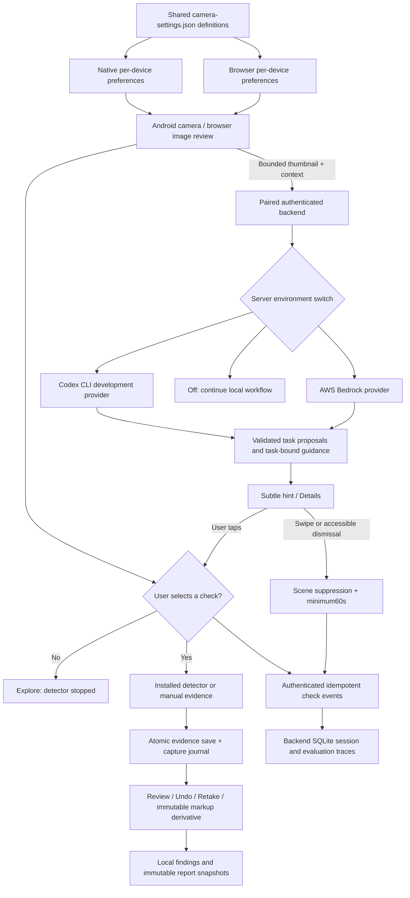

# Burhan1.2 architecture

Camera lifecycle and detector execution are local. Remote proposals do not execute camera actions automatically. Logical context versions invalidate old responses on selection changes; stable physical scene changes separately govern task suppression. Guidance is associated with its intended task. Provider selection and credentials remain server-side. The existing public API base and paired device authorization are retained.

Evidence schema additions are optional within workspace schemaVersion1. `captureSource` records the effective `analysis`, `photo` or `import` source; width/height describe the retained image. `detectorBaseline` is an immutable image reference. `annotations` version1 contains at most200 arrow/ellipse shapes, each with four normalized coordinates. Annotation editing writes a new image reference. Old reports retain the references copied when generated; portable backups include their referenced media too.

Changing preferences does not change evidence already stored. Per-device camera preferences are separate from pairing secrets and workspace backup settings. Native main Settings and the camera settings activity read the same SharedPreferences store through `getCameraPreferences`/`setCameraPreferences`; labels/defaults come from the same packaged JSON used by the browser.
