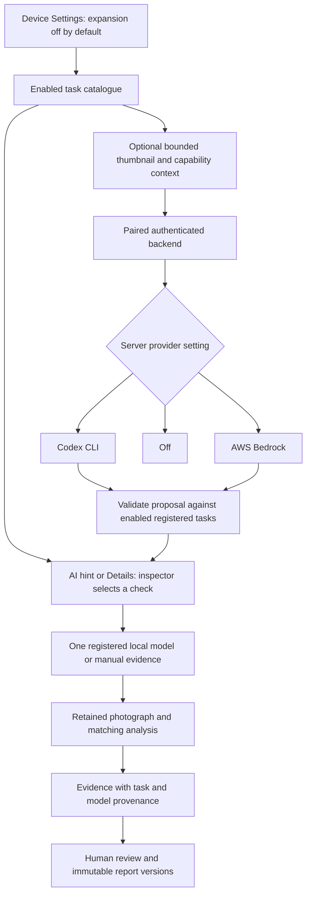

# Burhan 1.3 capability flow

Research families and category IDs are separate from the neural model identity. The shared catalogue binds five categories to three installed model IDs; the other 25 expanded checks are manual. Existing PPE/crack/surface modes remain the default. No model path or command comes from provider output.

Android uses CameraX and ONNX Runtime Android with OpenCV. Browser preview runs separately from a serialized inference worker. Selection changes advance the local generation/epoch and clear overlays; obsolete work cannot activate checks, replace guidance or save an old check's capture.

Session and turn context carries `expandedInspectionModels` and `installedModelIds`. Both fields are optional and default to expansion disabled. The backend owns the registry and filters it for every turn; no client model identifier becomes an executable path. Registered model availability permits a proposal, not detector execution. Only a user selection starts the matching local detector.

Evidence optionally retains `provenance` (task/category/family, experimental status, successfully executed model ID/checksum and thresholds) and inspector-entered `measurements`. Existing schema-version1 workspaces/backups remain readable. Old report snapshots are not migrated or rewritten after preference changes or edits.
