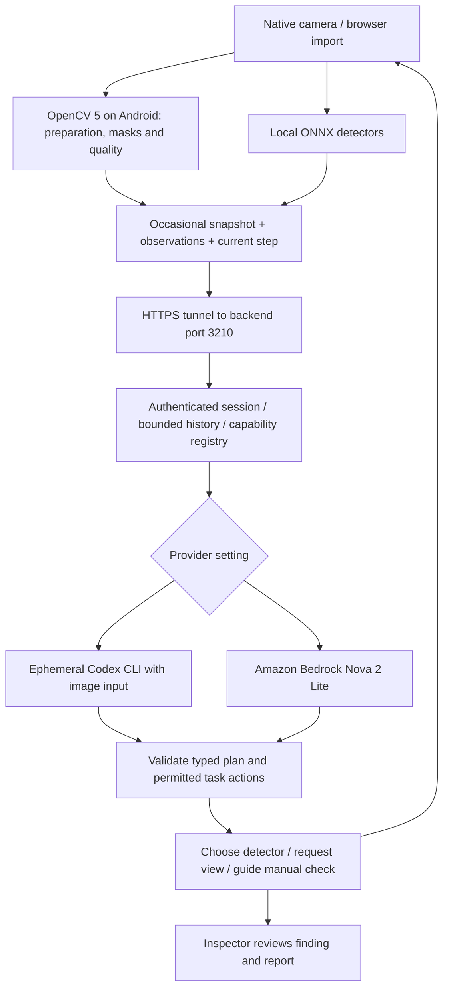

# Smart Inspection setup, architecture and troubleshooting

Burhan combines local camera detection with a scene-aware inspection guide. The guide suggests relevant checks, chooses an installed detector, requests a clearer view, or guides a manual measurement. It does not create new trained detectors or certify construction quality.

## Start and pair

From the Burhan folder:

```powershell
Copy-Item backend/.env.example backend/.env
powershell -NoProfile -File backend/start.ps1 -Install
```

Keep `SMART_INSPECTION_PROVIDER=codex` initially. Codex must be installed and signed in (`codex login status`). The startup script uses the existing project environment or creates a private backend environment when needed. Local CLI execution still sends images and context to online inference under the signed-in account's usage limits.

The server listens on `127.0.0.1:3210`. Keep the existing tunnel forwarding `https://merhaba-api.kiyan.finance` to this listener. The app uses that public HTTPS origin, since localhost on a phone points at the phone itself.

Startup prints a pairing code, also stored in `backend/data/pairing.json`. In app Settings, enter that code and tap Pair device. It expires one hour after server startup; restart for a fresh code. Previously paired tokens survive backend restarts and expire after 30 days. Tokens stay out of inspection backups. Pair browser and phone separately.

## Switch providers without rebuilding

Edit only this entry in `backend/.env`, then stop/restart the server:

```env
SMART_INSPECTION_PROVIDER=codex
```

Allowed values:

| Value | Planning engine | Requirements |
|---|---|---|
| codex | Installed Codex CLI | Developer computer online, CLI signed in, account usage available |
| aws | Bedrock Nova 2 Lite | AWS credentials/role and model access on backend; defaults to us-east-1 and US inference profile |
| off | Remote assistance disabled | Offline camera/detection/reports continue |

Do not change the app URL when switching providers. Cloud host deployment and teardown are documented in backend/README.md; using Bedrock from the local backend also executes the planner on AWS. A locally running Codex demonstration alone does not establish the competition's AWS requirement. Neither provider silently falls back to the other.

## How the loop works



The browser uses thumbnail quality estimates; the backend independently computes OpenCV5 image metrics. These metrics are capture hints, not calibrated physical measurements. Android OpenCV5 additionally prepares actual model inputs and interprets masks/components. The agent's scene score is not a calibrated probability of correctness.

Snapshots are throttled to at most one every ten seconds. Camera detection does not await model planning. Sustained scene changes, corrections, pause and closure invalidate obsolete results. The selected check remains active until the user deselects, stops, completes, skips or explicitly switches it. AI results propose checks and never silently activate another detector. Instructions are tied to their intended task; scene-scoped dismissals suppress rejected recommendations. The backend keeps bounded history across model turns and provider restarts.

The default backend permits one active planner, 60 turns per inspection, and 300 account-wide turns per rolling day. Online planning may take tens of seconds, particularly Codex startup or account contention. Token-based AI charges/usage are additional to backend infrastructure; measure actual provider usage before raising limits.

## Troubleshooting

| Symptom | Action |
|---|---|
| Public domain returns 502 | Start backend, check localhost3210 health, then check the tunnel origin mapping |
| Pairing rejected | Use current startup code, check code expiry; wait one minute after repeated failed attempts |
| Paired but assistant unavailable | Check health/provider, CLI login/limits or AWS credentials/model permission; local scanning continues |
| Guidance is stale or wrong | Correct the scene or skip; do not use a model suggestion as a confirmed finding |
| Rate-limit message | Wait ten seconds; account/session limits are backend settings |
| Imported photo does not produce a plan | Start the assistant first, ensure paired status, then import a supported image |
| Python smoke test gets Cloudflare1010 | The verification script supplies an explicit Burhan user agent; do not disable tunnel protections |
| App cannot reach localhost | Keep the app on the public HTTPS URL, not 127.0.0.1 |

## Verification and limits

Run backend unit/integration tests as documented in backend/README.md, `npm run verify`, the numerical inference parity test, and `npm run build:apk`. A real online verification command is available from the parent project root:

```powershell
.venv/Scripts/python.exe burhan/scripts/test-smart-backend.py --image path/to/permitted-photo.jpg
```

It uses the real selected provider through the public tunnel, compares original and deliberately blurred imagery, acknowledges suggestions without claiming physical tool execution, and saves a credential-free trace. This is a workflow test, not a scene/damage accuracy benchmark.

The updated APK must still be checked on the user's physical phone: pairing, cloud pause, background/rotation, scene transitions, imported-image reanalysis, saved evidence provenance, sustained heat and PDF export. The user reported the previous build worked on their phone; that does not validate new native code. Live AWS results must be recorded using real credentials before claiming AWS demonstration success.


Burhan1.2 camera behavior and optional tools: [Camera & Capture](camera-settings.md). The authenticated idempotent check-event endpoint records proposals and user decisions separately from detector execution; selecting a proposal is an explicit user action.
