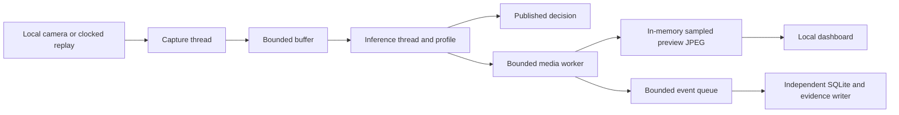

# Implemented edge runtime

Version 0.1.0, 20 October 2026. This document describes implemented behavior; [product-plan.md](product-plan.md) describes the target architecture.

## Execution paths



One edge station is active per process. Profile switching stops the previous source/worker before creating a new session. The capture thread owns and releases the camera. The inference thread owns profile processing; operator calibration/capture/reset are serialized against it.

Capture sources are generated demo, camera:index, file:absolute-path, image:absolute-path, images:absolute-folder and pdf:absolute-path. Video files follow their source timeline by default, skipping intervening frames explicitly when inspection runs slower than source FPS. Sequential review is available with `video_mode=every_frame`; bounded inference can still drop observations. Per-frame indices, timestamp semantics, source/analysis dimensions and replay lag are exposed. See [video inspection](video-inspection.md). Construction rejects demo and PDF sources. Single stills repeat until stopped; folders/PDFs hold each item for 30 seconds by default (configurable) and finish explicitly. Repeated pixels are not independent samples. See [real-inputs.md](real-inputs.md) for geometry, replay and model configuration.

Windows camera capture uses MSMF, verified on this laptop. Camera receipt time is measured after read(); backend/exposure delay is unknown. Capture buffer-size requests are best effort. A blocked native camera read cannot be forcefully interrupted by Python: stop waits a bounded interval and reports a still-closing source rather than starting a second camera owner.

## Buffering and domain outcomes

Factory uses a FIFO buffer of four packets; overflow rejects new work and reports drops. Freight, roads and construction retain the latest pending packet and report discarded stale packets. The model does not run on a growing backlog.

In factory triggered mode, a local trigger creates a unit ID and an absolute deadline. Subsequent frames retain that ID until a supported terminal result or the deadline. Pending confirmation is allowed within the budget. Queued work arriving late, inference finishing late, input failure, station shutdown or queue rejection generates an explicit missed outcome. These are software timing rules, not an industrial safety or item-association qualification. Manual-review factory policies deliver `review` or `no_candidate` observations; completed-unit telemetry means an observation was delivered. Physical unit disposition stays `not_decided`, with no automatic acceptance, rejection or actuation.

Video `source_skipped` counts source frames not captured for inference. Coverage gaps include these plus dropped captured packets; they do not measure geographic distance or certify physical item coverage. RoadsProfile handles overlap tracks, not global physical defect identity. Freight latest-frame behavior applies to guidance; accepted document types and OCR cache stay within the profile until reset/session restart. OCR is performed on stabilized new pages and reused for matching views; it does not run on every frame.

The preview JPEG is encoded after the decision; its encoding and UI fetch/render time are excluded from the reported host-receipt-to-decision latency. Captured/processed FPS are session-average rates, including source/capture startup after model construction. Model construction occurs before the active session clock; benchmarks record that station-start cost separately. Percentile samples are bounded to the latest 2,000 processed frames. Maximum latency is the maximum within that retained timing window. Stale packets discarded before processing are counted separately and are not latency samples.

JPEG encoding runs in an independent media worker. Preview has one replaceable slot, a configurable 0–15 FPS upper limit (default six), and a 960-pixel long-side limit. Selected event images retain full annotated resolution and immutable metadata. At most four event images are queued; pending and in-flight raw images share a 32 MiB budget. A rejected/failed event image retains its finding metadata with an error marker. Preview replacements and throttling do not count as inspection drops. `media`, `preview_sequence` and `preview_age_ms` expose this separate path; stop/switch refuses a new station until media ownership closes. See [performance study](performance-study.md).

Finite sources enter `draining` before `eof`; pending inference finishes before elapsed time freezes. Idle inference polling expires accepted factory triggers even when no new camera frame arrives, and source completion settles units without terminal results. Freight can finalize the actual retained final-page OCR after EOF, bounded to 45 seconds. Such completion preserves the original frame identity, has a separate `async_source_completion` marker and OCR job time, and does not increment frame counts or enter guidance latency percentiles. Its per-frame timing/late fields are null. Stop/switch refuses a second station if the previous native OCR worker has not closed. See [real-input verification](real-input-verification.md).

## Evidence and provenance

FrameContext identifies source, session, sequence, host receipt time, optional source timestamp and optional unit ID. Findings use analysis-frame x/y/width/height coordinates and method-specific scores. Large video frames are bounded to a 1,920-pixel long side; per-packet source and analysis dimensions preserve the mapping to original pixels. These are not calibrated physical measurements. Each persisted finding contains source identity, timing, provenance label, domain measurements, domain state and method/version attribution.

Event-image saving is off by default. Local event records are retained up to 1,000 rows and selected JPEGs up to 50 MiB by default. The writer additionally bounds payload, media and pending queue bytes; see [runtime-storage.md](runtime-storage.md). Disk writes are outside the inference thread. Queue loss is surfaced, not hidden. Exports contain the most recent 200 events and runtime state; they are not a complete indefinite archive or cryptographic audit log.

Raw previews and calibration remain in process memory. OCR text/fields can be included in persisted events and exports even when event-image saving is off. Model packages are installed/downloaded explicitly before inference; third-party OCR model resolution is pointed at existing local model files. No cloud inference is configured. Installed-model smoke checks deny outbound socket connections. Cloud status explicitly reports disabled. Reconnection, package distribution, persistent calibration and full offline sync are future work.

## Local API

| Method and route | Purpose |
|---|---|
| GET / | Offline dashboard |
| GET /api/profiles | Supported adapter descriptions |
| GET /api/presets | Available explicitly configured public-data examples |
| GET /api/construction/catalog | Saudi stage checklist and installed visual-model scope; all topics unassessed |
| GET /api/construction/videos | Available attributed, actual annotated recordings |
| GET /api/construction/videos/{identifier} | Allowlisted local H.264 viewing copy, with byte-range support |
| GET /api/state | Live result, timing, storage and source health |
| POST /api/start | Start/switch one local station |
| POST /api/stop | Stop station; preserve last preview/result for inspection |
| POST /api/actions/reset | Reset profile temporal/session state |
| POST /api/actions/calibrate | Approve current factory reference, subject to quality validation |
| POST /api/actions/capture | Request next quality-approved supported freight page |
| POST /api/actions/trigger | Accept a manually identified factory unit in triggered mode |
| GET /api/preview.jpg | In-memory annotated JPEG; 503 before a frame |
| GET /api/events?limit=20 | Bounded recent local history |
| GET /api/export | Download runtime/event JSON |

Start accepts profile, source, input_fps, width, height, deadline_ms, save_evidence, triggered, profile_options, source_hold_seconds, preview_fps and video_mode (`realtime` by default). The options JSON object is passed to the selected local adapter, while the runtime sets the actual demo flag from source provenance. Defaults are factory, demo, 8 FPS, 960x540, 350 ms, false, false, {}, 30 seconds and 6 preview FPS. REST and direct runtime calls validate finite FPS/deadline ranges. API control requires JSON and rejects a mismatched browser Origin; the development server binds loopback.

Example local control:

```powershell
Invoke-RestMethod -Method Post -Uri http://127.0.0.1:8765/api/start -ContentType application/json -Body '{"profile":"freight","source":"demo","input_fps":8}'
Invoke-RestMethod -Uri http://127.0.0.1:8765/api/state
Invoke-RestMethod -Method Post -Uri http://127.0.0.1:8765/api/stop -ContentType application/json -Body '{}'
```

## Source files

- edge_runtime/contracts.py: adapter inputs/results and coordinate conventions.
- edge_runtime/sources.py: local sources and a media-free camera probe.
- edge_runtime/buffer.py: bounded queue policies.
- edge_runtime/runtime.py: station lifecycle, capture/inference, deadlines and metrics.
- edge_runtime/storage.py: immutable asynchronous local event writer.
- edge_runtime/media.py: bounded preview/evidence encoding outside inspection.
- edge_runtime/app.py and cli.py: loopback API and startup.
- edge_runtime/profiles/: independent factory, freight, roads and construction analysis.
- edge_runtime/static/: offline dashboard with no external assets.

The current reference detector and road heuristic require their documented operating conditions. The architecture's extensibility is not evidence that their accuracy generalizes to arbitrary products or roads.

## Construction scope

Construction selects one pinned local PPE or surface-crack model per station, with explicit CPU/GPU settings. Optional normalized ROI limits the inspected field; pixels outside it remain unassessed. Box-only rendering avoids dense mask reconstruction when configured. Findings are candidates for review, never code-compliance decisions. The 89-topic, 16-stage Saudi research catalog records the evidence and authority decisions that video cannot provide; see [the study](saudi-construction-inspection-study.md) and [model evaluations](construction-vision.md).
